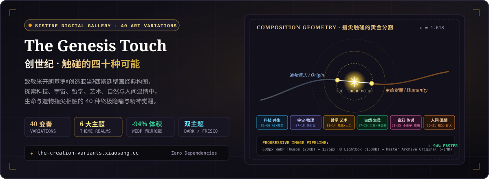
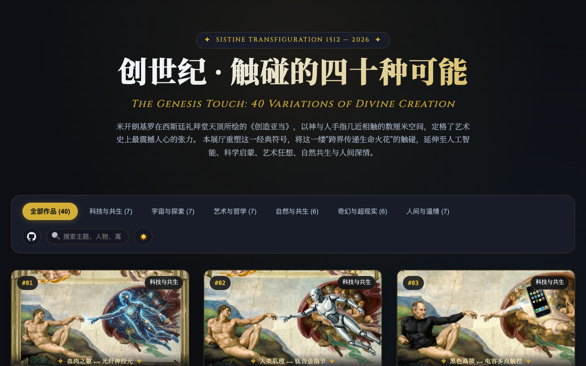

<p align="right"><a href="README.md">中文</a></p>

<p align="center">
  
</p>

<p align="center">
  <a href="https://the-creation-variants.xiaosang.cc/">▶ Visit the Gallery</a>
  ·
  <a href="https://github.com/holynova/the-creation-variants">GitHub Repository</a>
</p>

The Genesis Touch is an immersive digital gallery paying tribute to Michelangelo's *The Creation of Adam* — the moment God's fingertip nearly touches Adam's. That iconic composition is extended into 40 variations across 6 themes: from humanity touching AI, to an astronaut touching alien life, to a child holding their white-haired grandfather's hand. Every work carries its touch subject, symbolic reading and an inscribed quote.

## Screenshot

<p align="center">
  
</p>

## The Collection

40 works, 6 themes:

| Theme | Count | Examples |
| :--- | :---: | :--- |
| 科技与共生 Technology & Symbiosis | 7 | 人类与人工智能 Humanity & AI, 乔布斯与初代 iPhone Steve Jobs & the first iPhone, 图灵与神秘苹果 Turing & the mysterious apple |
| 宇宙与探索 Cosmos & Exploration | 7 | 宇航员与外星生命 Astronaut & alien life, 牛顿与引力苹果 Newton & the gravity apple, 旅行者 1 号与暗淡蓝点 Voyager 1 & the pale blue dot |
| 艺术与哲学 Art & Philosophy | 7 | 米开朗基罗与大卫像 Michelangelo & David, 梵高与炽烈向日葵 Van Gogh & the blazing sunflowers, 敦煌画工与九色鹿 Dunhuang painter & the nine-colored deer |
| 自然与共生 Nature & Symbiosis | 6 | 自由潜水员与座头鲸 Free diver & humpback whale, 巡护员与白犀牛 Ranger & white rhino, 孩童与大地之母盖亚 Child & Gaia, mother earth |
| 奇幻与超现实 Fantasy & Surrealism | 6 | 小王子与独一无二的玫瑰 The Little Prince & his one-of-a-kind rose, 青年与未来的自己 A young man & his future self, 爱丽丝与柴郡猫的微笑 Alice & the Cheshire Cat's grin |
| 人间与温情 Humanity & Warmth | 7 | 孩童与白发祖父 Child & white-haired grandfather, 盲人与导盲犬 A blind person & their guide dog, 产科医生与新生奇迹 Obstetrician & a newborn miracle |

## Experience

- **Two gallery themes**: Sistine Dark （西斯廷暗夜） and Fresco Parchment （壁画羊皮纸）, switchable with one click, preference saved locally.
- **Filter & search**: filter by the 6 themes; live search across titles, touch subjects, symbolism and quotes.
- **HD lightbox**: open any work for a high-resolution view with its touch close-up and curatorial reading; Esc closes it.
- **Three-tier images**: WebP thumbnails for the grid, WebP HD for the lightbox, JPG originals archived — light first screen, crisp details.

## Run Locally

Zero build, zero dependencies — just open `index.html`, or serve it statically:

```bash
python3 -m http.server 8000
# Open http://localhost:8000
```

## Tech

- Pure HTML + CSS + JS, zero external dependencies; all metadata for the 40 works lives in `data.js` (title, touch subject, symbolic reading, quote, tags).
- Three image tiers: `images/thumbs-webp/` (grid thumbnails), `images/detail-webp/` (lightbox HD), `images/*.jpg` (archived originals).

```
index.html      Gallery entry (filter bar / work grid / lightbox)
styles.css      Two themes (dark night / parchment) and responsive layout
app.js          Filter / search / theme switching / lightbox
data.js         Metadata for 40 works
images/         Original JPGs + thumbs-webp + detail-webp
```
