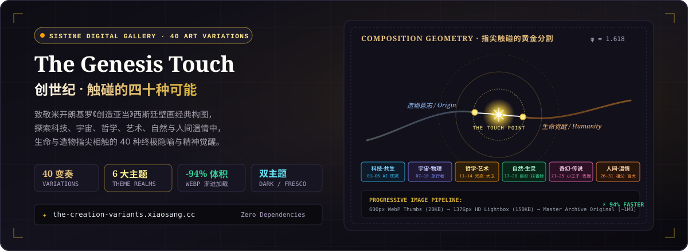
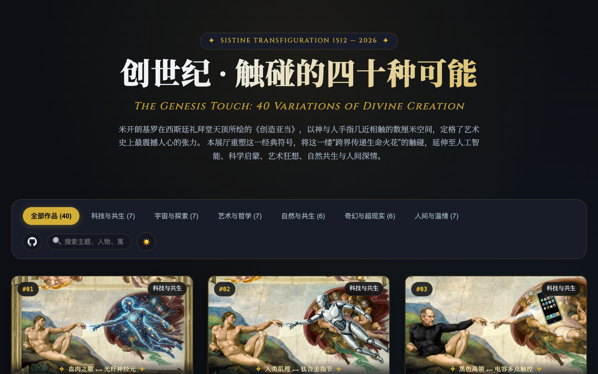

<p align="right"><a href="README.en.md">English</a></p>

<p align="center">
  
</p>

<p align="center">
  <a href="https://the-creation-variants.xiaosang.cc/">▶ 在线观展</a>
  ·
  <a href="https://github.com/holynova/the-creation-variants">GitHub 仓库</a>
</p>

创世纪 · 触碰的四十种可能是一座沉浸式数字艺术展厅，致敬米开朗基罗《创造亚当》——上帝与亚当指尖相触的瞬间。我们把这一经典构图延伸至 6 大主题、40 幅变种：从人类触碰 AI，到宇航员触碰外星生命，到孩童握住白发祖父的手。每幅作品都有触碰主体、象征解读与铭刻名言。

## 截图

<p align="center">
  
</p>

## 展品

40 幅作品，6 大主题：

| 主题 | 数量 | 举例 |
| :--- | :---: | :--- |
| 科技与共生 | 7 | 人类与人工智能、乔布斯与初代 iPhone、图灵与神秘苹果 |
| 宇宙与探索 | 7 | 宇航员与外星生命、牛顿与引力苹果、旅行者 1 号与暗淡蓝点 |
| 艺术与哲学 | 7 | 米开朗基罗与大卫像、梵高与炽烈向日葵、敦煌画工与九色鹿 |
| 自然与共生 | 6 | 自由潜水员与座头鲸、巡护员与白犀牛、孩童与大地之母盖亚 |
| 奇幻与超现实 | 6 | 小王子与独一无二的玫瑰、青年与未来的自己、爱丽丝与柴郡猫的微笑 |
| 人间与温情 | 7 | 孩童与白发祖父、盲人与导盲犬、产科医生与新生奇迹 |

## 体验

- **双美术馆主题**：Sistine Dark（西斯廷暗夜）与 Fresco Parchment（壁画羊皮纸），一键切换，偏好记在本地。
- **筛选与检索**：按 6 大主题快速筛选；实时检索标题、触碰主体、象征隐喻与名言。
- **高清灯箱**：点开任意作品看高清细节、触碰微距与艺术解读，支持键盘 Esc 关闭。
- **三层图片架构**：列表用 WebP 缩略图、灯箱用 WebP 高清图、原图 JPG 归档，首屏轻、细节清。

## 本地运行

零构建、零依赖，直接打开 `index.html`，或起一个静态服务器：

```bash
python3 -m http.server 8000
# 打开 http://localhost:8000
```

## 技术

- 纯 HTML + CSS + JS，零外部依赖；40 幅作品的全部元数据在 `data.js`（标题、触碰主体、象征解读、名言、标签）。
- 三层图片：`images/thumbs-webp/`（列表缩略图）、`images/detail-webp/`（灯箱高清）、`images/*.jpg`（原图归档）。

```
index.html      展厅入口（筛选栏 / 作品网格 / 灯箱）
styles.css      双主题（暗夜 / 羊皮纸）与响应式布局
app.js          筛选 / 检索 / 主题切换 / 灯箱
data.js         40 幅作品元数据
images/         原图 JPG + thumbs-webp + detail-webp
```
